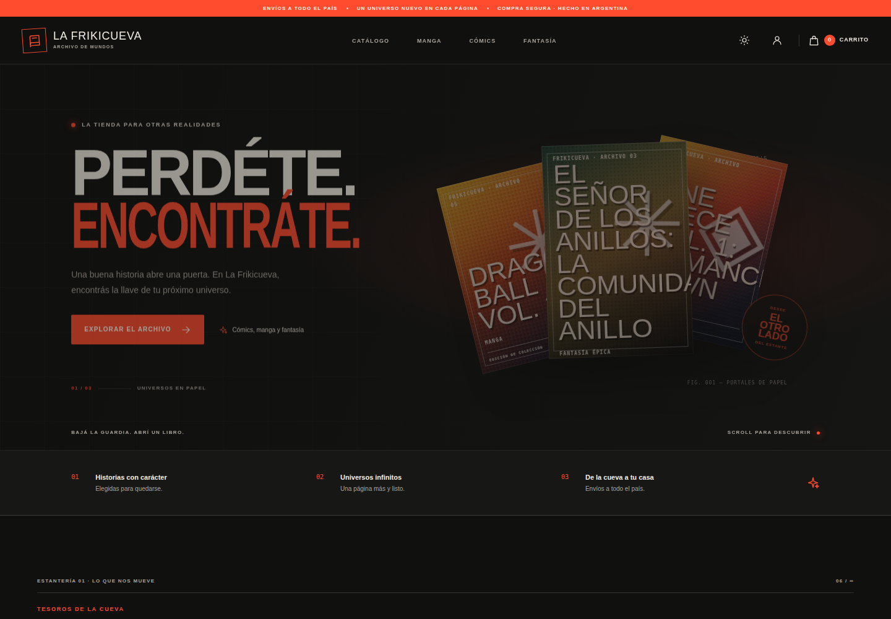

# La Frikicueva — EFI (Frontend)

Tienda online argentina de **cómics, manga y libros**. Este repositorio es el **frontend** (Next.js) y consume la API REST del grupo, hecha con Django y Django REST Framework.



- **Aplicación desplegada:** _https://frikicueva.vercel.app/_
- **Repositorio del backend:** _https://github.com/Lucasaruza17/efi_ing_
- **Tablero Kanban:** _pendiente de linkear_
- **Documentación de la API (local):** `http://localhost:8000/api/docs/swagger/`

## Funcionalidades

| Área | Qué incluye |
| --- | --- |
| Catálogo | Búsqueda, filtro por categoría (Cómic, Manga, Libros), orden por precio/título y paginación, todo conectado a los filtros del backend. La URL se puede compartir (`/catalogo?categoria=manga`). |
| Fichas | Detalle de cada edición (`/catalogo/[id]`) con autores, editorial, stock y portada. |
| Carrito y pedidos | Carrito, checkout básico, listado, detalle y cancelación de pedidos. |
| Cuenta | Registro, login/logout con token, perfil de cliente. |
| Gestión (staff) | CRUD de productos (`GET`, `POST`, `PATCH`, `DELETE /api/productos/`) con stock y pasillo. La API solo permite escribir a usuarios staff. |
| Experiencia | Tema claro/oscuro, portadas ilustradas, microanimaciones, estados de carga y error, página 404. |

Si la API no responde, la tienda muestra una **vista de muestra** (con aviso) para poder recorrer el diseño.

## Portadas

Cada producto muestra su **tapa real** cuando tiene cargado el campo `imagen_url` (desde el panel de gestión, al crear o editar). Acepta dos formas:

- **Imagen descargada:** guardala en `public/portadas/` (por ejemplo `public/portadas/berserk-1.jpg`) y cargá la ruta `/portadas/berserk-1.jpg`. Es lo más estable: no depende de ningún sitio externo. Ojo: la carpeta `public/` tiene que estar commiteada en git (si no, Vercel no la publica) y el nombre del archivo tiene que coincidir exacto, con mayúsculas y minúsculas.
- **Link:** una URL `https://…` directa a la imagen.

Si el producto no tiene imagen, o el link falla, se muestra una ilustración SVG según su categoría (cómic, manga o libros).

## Stack

- Next.js 16 (App Router) y TypeScript.
- Server Components para inicio, fichas y primera carga del catálogo; Client Components para filtros, sesión, carrito y formularios.
- Tailwind CSS 4 + CSS propio.
- React Hook Form + Zod para formularios.
- Context API para sesión, tema y carrito.
- Vitest para pruebas unitarias.

## Estructura

```text
app/(store)/        rutas: inicio, catálogo, carrito, login, registro, cuenta, admin
components/         UI reutilizable (catálogo, portadas, header, formularios)
lib/                cliente de la API, esquemas Zod, utilidades, datos de muestra
outputs/            capturas para este README
```

## Ejecutar en local

Requisitos: Node.js 20.9 o superior y el backend Django corriendo.

```bash
npm install
```

Crear `.env.local` con la URL del backend:

```env
NEXT_PUBLIC_API_URL=http://localhost:8000/api
```

```bash
npm run dev
```

Abrir `http://localhost:3000`. El backend debe permitir CORS desde `http://localhost:3000`.

**Usuario de prueba:** `cliente_demo` / `demo1234` (lo crea `python populate.py` en el backend). Completá **Mi perfil** antes de confirmar un pedido.

## Scripts

| Comando | Descripción |
| --- | --- |
| `npm run dev` | Servidor de desarrollo |
| `npm run build` | Build de producción |
| `npm run start` | Sirve el build |
| `npm run test` | Pruebas con Vitest |

## Tablero Kanban

Organizamos el trabajo del equipo con un tablero Kanban. Estado final del proyecto:

| 📥 Backlog | 📝 To Do | 🚧 In Progress | 🔍 In Review | ✅ Done |
|---|---|---|---|---|
| 🟦 Panel de administración de productos<br><br>🟩 Paginación y ordenamiento en endpoints | 🟦 Carrito de compras<br><br>🟦 Filtros y búsqueda por categoría<br><br>🟧 Aumentar cobertura de tests | ⬜ Completar README.md (instalación, variables, capturas) | 🟦 Mejoras de UI y responsive<br><br>🟧 Tests con Vitest de componentes principales | 🟩 Modelos y API REST con Django REST Framework<br><br>🟩 Autenticación con JWT (login/registro)<br><br>🟦 Setup del proyecto Next.js + TypeScript + Tailwind<br><br>🟦 Catálogo de productos consumiendo la API<br><br>🟦 Detalle de producto<br><br>🟪 Deploy del frontend en Vercel<br><br>🟪 Deploy del backend en Render + Supabase |

**Referencias:** 🟦 Frontend · 🟩 Backend · 🟧 Testing · 🟪 Deploy · ⬜ Docs


## Equipo

- Lucas Aruza
- Mateo Gonzalez
