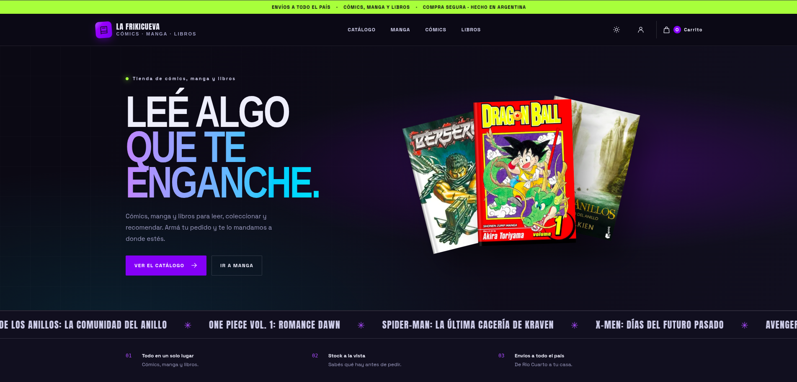
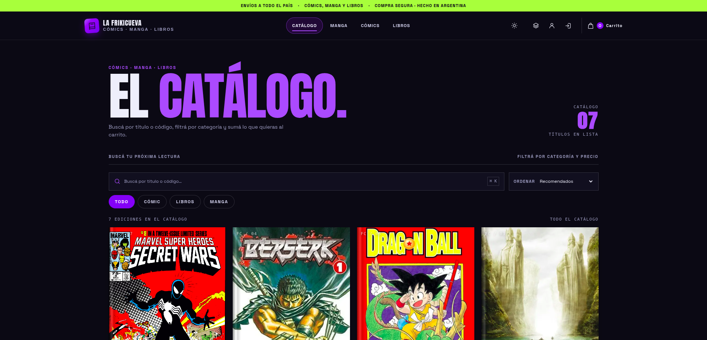
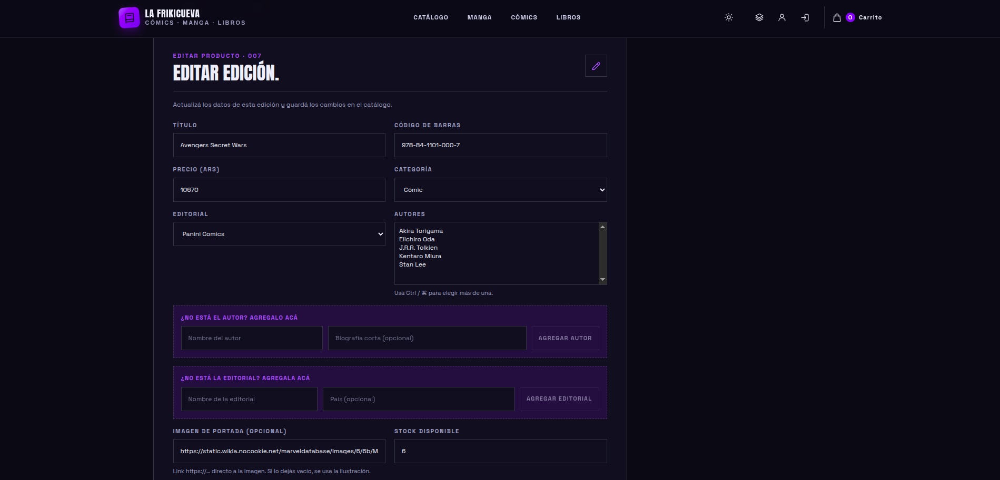
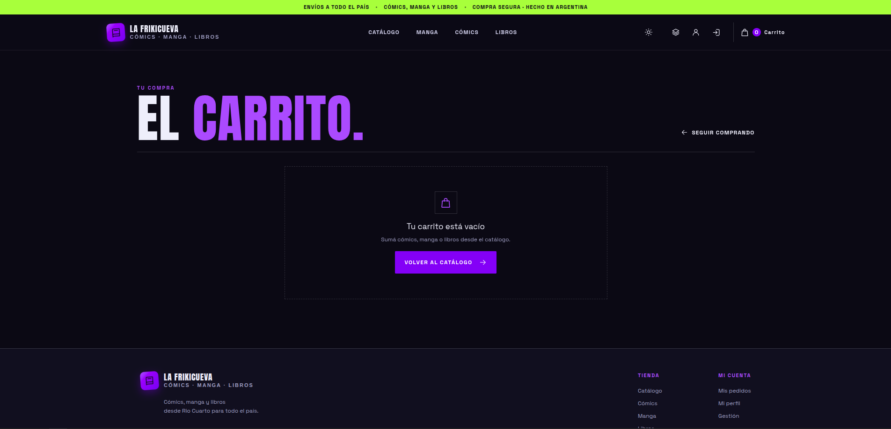
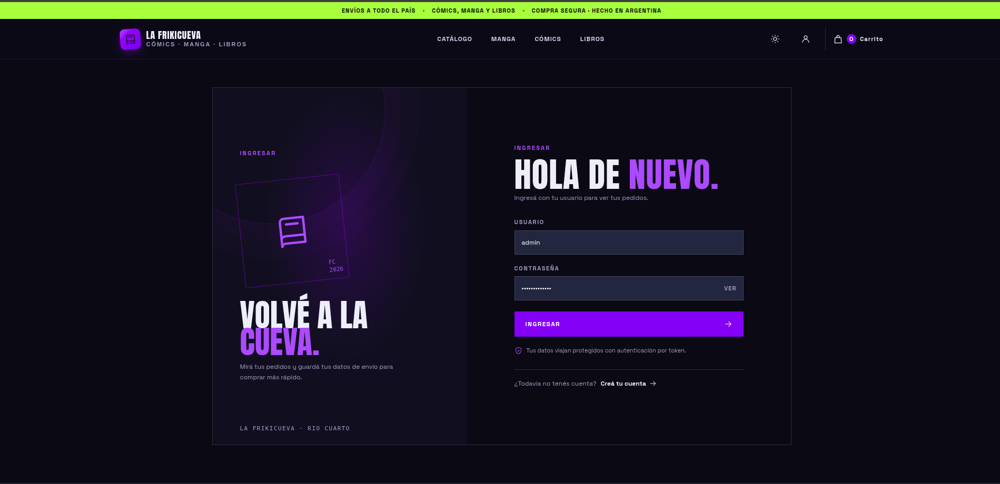
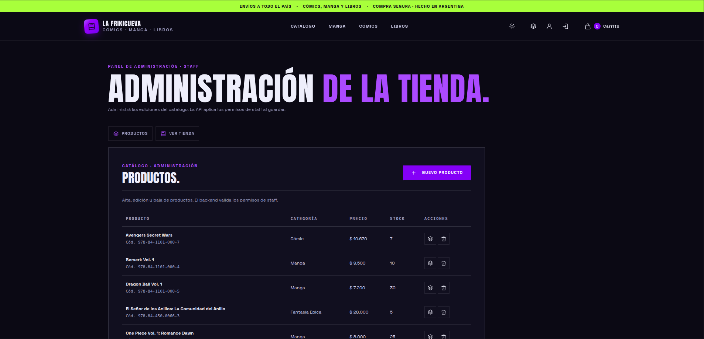
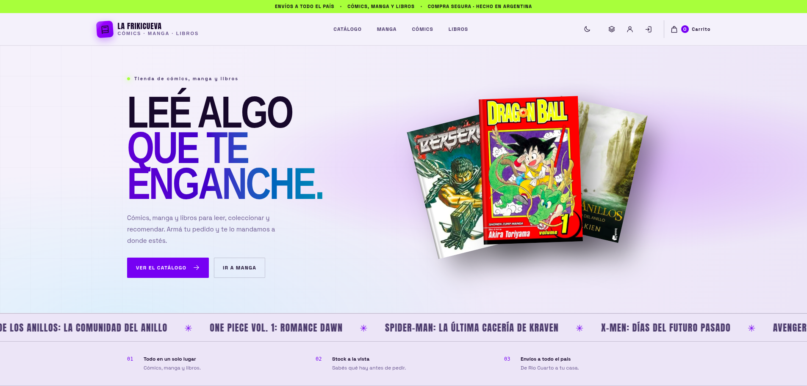

# La Frikicueva — EFI (Frontend)

Tienda online argentina de **cómics, manga y libros**. Este repositorio es el **frontend** (Next.js) y consume la API REST del grupo, hecha con Django y Django REST Framework.

- **Aplicación desplegada:** _https://frikicueva.vercel.app/_
- **Repositorio del backend:** _https://github.com/Lucasaruza17/efi_ing_
- **API desplegada (Render + Supabase):** https://la-frikicueva-api-k2rw.onrender.com/
- **Documentación de la API (Swagger):** https://la-frikicueva-api-k2rw.onrender.com/api/docs/swagger/
- **Documentación local:** `http://localhost:8000/api/docs/swagger/`

## Funcionalidades

| Área | Qué incluye |
| --- | --- |
| Catálogo | Búsqueda, filtro por categoría (Cómic, Manga, Libros), orden por precio/título y paginación, todo conectado a los filtros del backend. La URL se puede compartir (`/catalogo?categoria=manga`). |
| Fichas | Detalle de cada edición (`/catalogo/[id]`) con autores, editorial, stock y portada. |
| Carrito y pedidos | Carrito, checkout básico, listado, detalle y cancelación de pedidos. |
| Cuenta | Registro, login/logout con token, perfil de cliente. |
| Gestión (staff) | CRUD de productos (`GET`, `POST`, `PATCH`, `DELETE /api/productos/`) con stock y pasillo. La API solo permite escribir a usuarios staff. |
| Experiencia | Tema claro/oscuro, portadas ilustradas, microanimaciones, estados de carga y error, página 404. |

Si la API no responde, el catálogo público muestra una **vista de muestra** (con aviso). El panel de gestión no usa datos de muestra: si falla la API, muestra el error.

## Capturas



<!-- Cuando subas las capturas a la carpeta capturas/, descomentá estas líneas:








-->

## Portadas

Cada producto muestra su **tapa real** cuando tiene cargado el campo `imagen_url` (desde el panel de gestión, al crear o editar). Se carga con un **link** `https://…` directo a la imagen.

Si el producto no tiene imagen, o el link falla, se muestra una ilustración SVG según su categoría (cómic, manga o libros).

## Stack

- Next.js 16 (App Router) y TypeScript.
- Server Components para inicio, fichas y primera carga del catálogo; Client Components para filtros, sesión, carrito y formularios.
- Tailwind CSS 4 (los colores del diseño están como tokens en `@theme`, en `globals.css`).
- React Hook Form + Zod para formularios.
- Context API para sesión, tema y carrito.
- Vitest para pruebas unitarias.

## Estructura

```text
app/(store)/        rutas: inicio, catálogo, carrito, login, registro, cuenta, admin
components/         UI reutilizable (catálogo, portadas, header, formularios)
lib/                cliente de la API, esquemas Zod, utilidades, categorías, menú, datos de muestra
tests/              pruebas unitarias de componentes, esquemas, menú y categorías
capturas/           imágenes para este README
```

## Ejecutar en local

Requisitos: Node.js 20.9 o superior y el backend Django corriendo.

```bash
npm install
```

Crear `.env.local` con la URL del backend:

```env
NEXT_PUBLIC_API_URL=http://localhost:8000/api
```

```bash
npm run dev
```

Abrir `http://localhost:3000`. Para apuntar a la API desplegada, usar `NEXT_PUBLIC_API_URL=https://la-frikicueva-api-k2rw.onrender.com/api`. El backend debe permitir CORS desde `http://localhost:3000`.

**Usuario de prueba:** `cliente_demo` / `demo1234` (lo crea `python populate.py` en el backend). Completá **Mi perfil** antes de confirmar un pedido.

## Tests

Las pruebas usan **Vitest** (con jsdom y Testing Library). La configuración está en `vitest.config.mjs` y `vitest.setup.ts`.

```bash
npm run test
```

| Archivo | Qué prueba |
| --- | --- |
| `lib/app.test.ts` | Esquemas de login, registro y producto, formato de precios, búsqueda, errores de la API, categorías y rutas de portadas |
| `tests/schemas.test.ts` | Cada regla de Zod por separado (login, registro, perfil, producto) |
| `tests/navigation.test.ts` | Qué link del menú queda activo según la URL |
| `tests/categories.test.ts` | Agrupación por categoría, precio inicial y autores de las tarjetas del inicio |
| `tests/components.test.tsx` | Cambio de tema (Context), campo de formulario, tarjeta de producto y tarjeta de categoría |

## Despliegue

La app está publicada en Vercel y la API (Django + Supabase) en Render. Ojo: si la API está en el plan gratuito de Render, la primera request después de un rato sin uso puede tardar hasta un minuto en responder.

La app se publica en Vercel. En el proyecto de Vercel hay que cargar la variable `NEXT_PUBLIC_API_URL` con la URL pública de la API (sin `localhost`) y volver a desplegar, porque Next.js la incluye al hacer el build.

## Scripts

| Comando | Descripción |
| --- | --- |
| `npm run dev` | Servidor de desarrollo |
| `npm run build` | Build de producción |
| `npm run start` | Sirve el build |
| `npm run test` | Pruebas con Vitest |

## Tablero Kanban y GitFlow

- **Tablero (GitHub Projects):** https://github.com/MateeGonzaa/efiProgIII/projects
- **Ramas (GitFlow):** `main` (versión entregada), `develop` (integración) y `feature/*` (una por funcionalidad, con su pull request hacia `develop`).

Estado del tablero al momento de la entrega:

| Tarea | Responsable | Estado |
| --- | --- | --- |
| Modelos y API REST con Django REST Framework | Lucas | Done |
| Autenticación con token (login, registro y logout) en la API | Lucas | Done |
| Deploy del backend en Render con base en Supabase | Lucas | Done |
| Setup de Next.js + TypeScript + Tailwind | Mateo | Done |
| Layouts, rutas anidadas y dinámicas, `not-found`, `loading` y `error` | Mateo | Done |
| Catálogo con búsqueda, filtros, orden y paginación | Mateo | Done |
| Detalle de producto | Mateo | Done |
| Login, registro y rutas protegidas (`AuthGate`) | Mateo | Done |
| Contexts de sesión, carrito y tema | Mateo | Done |
| Carrito y pedidos | Mateo | Done |
| CRUD de productos en el panel de gestión | Mateo | Done |
| Formularios con React Hook Form + Zod | Mateo | Done |
| Tests con Vitest | Mateo | Done |
| Deploy del frontend en Vercel | Mateo | Done |
| Limpieza del código: componentes y dependencias sin uso | Mateo | Done |
| Panel de gestión sin datos de muestra y con todas las páginas de productos | Mateo | Done |
| Portadas cargadas por link `https://` | Mateo | Done |
| Campo "ISBN" mostrado como "código de barras" | Mateo | Done |
| Logo e ícono con los colores nuevos (violeta y negro) | Mateo | Done |
| Textos de la tienda con Rio Cuarto | Mateo | Done |
| README actualizado (API desplegada, Swagger, Kanban) | Mateo | Done |
| Menú mobile con inicio de sesión, cuenta y carrito | Mateo | Done |
| Ajustes de responsive mobile (sin desbordes ni "zoom") | Mateo | Done |
| Responsive mobile v2: títulos fluidos, login/registro y carrito sin superposiciones, campos de 16px para que iOS no haga zoom | Mateo | Done |
| Ícono de la pestaña (`icon.svg`, `favicon.ico`, `apple-icon.png`) y logo del header en violeta y negro | Mateo | Done |
| Migrar los estilos globales a utilidades de Tailwind | Mateo | In Progress |
| Capturas de la app funcionando | Mateo | In Progress |

## Equipo

- Lucas Aruza
- Mateo Nicolás González